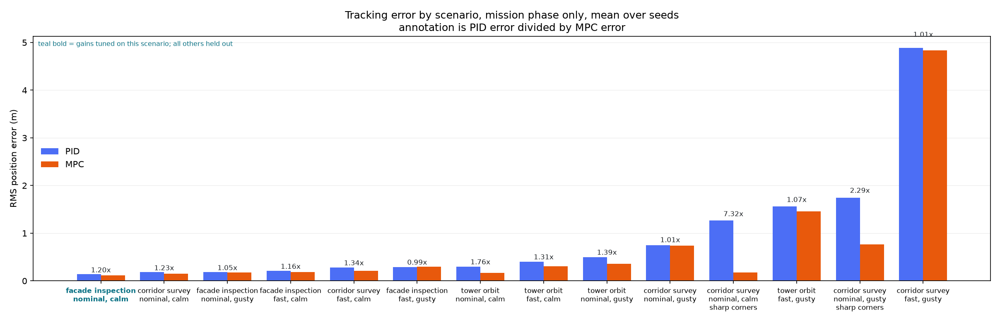
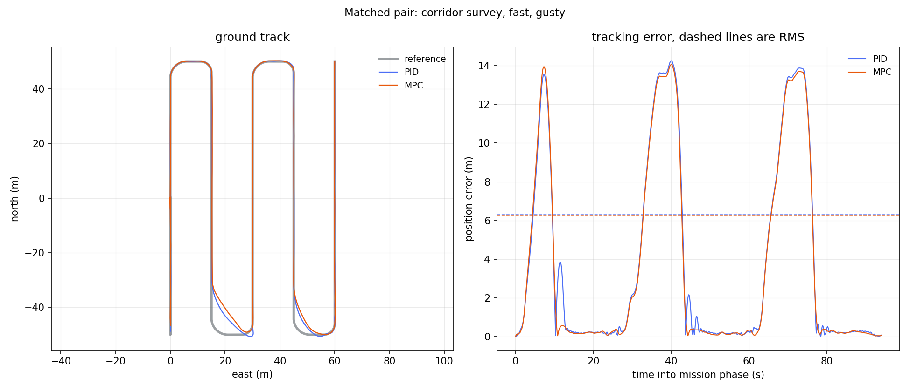
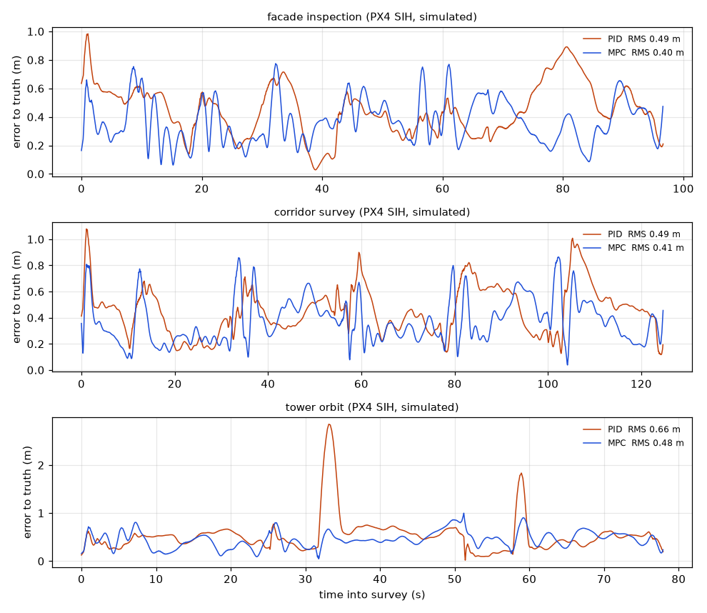

# drone-mission-control-px4-sitl

> ### Clean-room reimplementation
> This repository is an **independent reimplementation of a problem class**, built from
> scratch on personal time using public or synthetic data and open-source simulation.
> It is **not** derived from, and contains no material belonging to, any employer or
> client: no employer source code, schematics, calibration data, client data or internal
> documentation. It exists to demonstrate the architecture and engineering approach only.

A mission-control layer for an autonomous inspection multirotor, flown against PX4
software-in-the-loop. Compares MPC and PID trajectory tracking on identical missions,
with an RTK-GPS and IMU EKF state estimator, geofencing and a tested failsafe matrix.

The point of this repository is not that the aircraft flies. It is a **measured,
like-for-like comparison of model-predictive against PID trajectory tracking**: same
airframe, same missions, same wind, same sensor noise, same estimator, same inner loop,
with position error quantified against ground truth and an honest account of when the
extra complexity earns its place and when it does not.

**Every number in this README is simulated.** The headline comparison comes from this
repository's own 6-DOF reference simulation; the PX4 numbers come from PX4 v1.17.0
software-in-the-loop with PX4's SIH physics model. No aircraft was flown.



## The result (reference simulation)

Across 84 runs, 42 scenarios (3 missions × 2 speeds × 2 wind conditions × 3 seeds, plus
an infeasible-reference case) flown by both controllers on identical seeds:

| | PID | MPC |
| --- | ---: | ---: |
| Mean RMS position error | 0.907 m | **0.710 m** |
| Mean cross-track error | 0.292 m | **0.230 m** |
| Mean RMS jerk of the acceleration demand | 25.1 m/s³ | **17.1 m/s³** |
| Optimisation per control step | 358 µs | 1073 µs |
| Whole control step | 358 µs | 4462 µs |

**40 of 42 paired scenarios go to the MPC**, at a median error ratio of 1.23×. Full
numbers, including every scenario and the speed and wind breakdowns, are in
**[docs/RESULTS.md](docs/RESULTS.md)**, generated from the raw CSV and not written by
hand. The two timing rows are wall-clock measurements on the machine that generated
that document and are the only numbers here that do not reproduce exactly.

**The advantage is no smaller on the held-out scenarios than on the one it was tuned on**
(1.23× against 1.21×), which is the answer to the obvious objection.

### Where it comes from and where it doesn't

- **Preview is the whole mechanism and you can see it arrive.** On a feasible reference
  with rounded corners the gap is 1.21×. On an *infeasible* one, a lawnmower survey
  whose turnarounds are a velocity step no vehicle can follow, it is **4.80×**. The
  reason is visible in the saturation figures: on that case the PID spends **24% of the
  mission at a limit and the MPC 5%**. The PID chases the impossible reference into
  saturation; the MPC, which can see the step coming and knows its own acceleration
  bounds, declines to.
- **On long straight legs it very nearly doesn't matter.** The facade survey at nominal
  speed in calm air is 0.140 m against 0.116 m. One scenario, facade, fast, gusty, goes
  to the PID outright. If your missions look like that, the MPC is not worth the QP
  solver.
- **The MPC is smoother as well as tighter**, at 17.1 m/s³ of demand jerk against 25.1.
  Both were tuned against the same 25 m/s³ budget; the PID needed all of it and the MPC
  did not.
- **Some scenarios are beyond the airframe, not beyond the controller.** Where the
  vehicle is saturated 20 to 50% of the mission, both controllers converge and the error
  is a property of the trajectory. `docs/RESULTS.md` flags those explicitly rather than
  letting them read as a controller comparison.

So: **MPC where the reference is aggressive relative to the airframe** (tight corners,
continuous curvature, plans that were never quite flyable) **and PID where it is not**,
which on a gentle survey is most of the time.



## Against PX4 (SITL, simulated)

The same mission layer and trackers, unchanged, flown over MAVLink against PX4 v1.17.0
running its SIH physics model headless in Docker: every survey mission by both trackers,
and one flight per failsafe row with a real fault injected into PX4 or into the MAVLink
path. Errors are against SIH's ground truth from PX4's own ULog, computed by the same
code as the table above. Each row is a single flight in still air (SIH has no wind), so
these are not a statistical comparison.

<!-- sitl-table: begin (generated by analysis/make_sitl_results.py) -->
| Mission (PX4 SIH, simulated) | PID RMS | MPC RMS | PID cross-track | MPC cross-track | PID jerk | MPC jerk |
| --- | ---: | ---: | ---: | ---: | ---: | ---: |
| `facade inspection` | 0.49 m | 0.40 m | 0.38 m | 0.35 m | 32.0 m/s³ | 9.2 m/s³ |
| `corridor survey` | 0.49 m | 0.41 m | 0.33 m | 0.29 m | 19.1 m/s³ | 9.1 m/s³ |
| `tower orbit` | 0.66 m | 0.48 m | 0.30 m | 0.40 m | 21.8 m/s³ | 9.5 m/s³ |

| Failsafe (PX4 SIH, simulated) | Expected | Observed | Rule | Vehicle |
| --- | --- | --- | --- | --- |
| geofence breach | rtl | rtl | geofence_breach | landed |
| gnss loss | land | land | gnss_loss | landed |
| link loss | hold | hold | link_loss | landed |
| low battery | rtl | rtl | battery_low | landed |
<!-- sitl-table: end -->

With gains tuned for PX4 SIH the MPC is the more accurate on all three missions and much
the smoother; on the tower orbit the PID holds the path more tightly sideways but loses
more along it. Every injected fault produced the action its row of the matrix specifies.

Full detail, including loop rates, PX4 mode sequences and how each fault was injected,
is in **[docs/SITL_RESULTS.md](docs/SITL_RESULTS.md)**; how the flights are run and why
the trackers carry gains tuned for this airframe is in **[sitl/README.md](sitl/README.md)**.
The ULogs and the flight script's 50 Hz loop logs are committed under
[`sitl/results/`](sitl/results/) and the test suite recomputes the summary from them.

One finding from getting here is worth stating on its own. With the gains tuned for the
reference airframe both trackers flew PX4 but neither inside the jerk budget both were
tuned to and the PID spent much of the survey in a limit cycle between its acceleration
limits: PX4's command path is slower than the reference attitude loop. Both trackers
were then re-tuned for PX4 SIH by the same procedure and the table above uses those
gains. The reference-gain flights are kept as evidence in `sitl/results/transfer/`.



## Reproducing it

```bash
docker compose up
```

That builds a small Python image and runs the whole reference pipeline: the test suite,
the full scenario grid with both controllers, every failsafe scenario, all the figures,
and `docs/RESULTS.md`. It then **verifies** that each artifact exists and is non-empty,
that every scenario was flown by both controllers and that there is one log per run.
No ROS, no Gazebo, no GPU, no network. It ends with `END-TO-END PASSED`, or a non-zero
exit.

```bash
docker compose run --rm quick        # one seed, calm air, about a minute
docker compose run --rm comparison   # just the controller comparison
docker compose run --rm test         # just the test suite
docker compose run --rm tune         # re-tune both controllers from scratch
make sitl-smoke                      # one PX4 SITL flight, as CI flies it
make sitl-campaign                   # the whole PX4 SITL campaign
```

Without Docker:

```bash
pip install -r requirements.txt
PYTHONPATH=src bash scripts/run_all.sh
```

The reference comparison is deterministic. Every generator is seeded and results are
sorted before writing.

### What CI checks and when

On **every push and pull request**:

- the unit test suite, ruff and validation of every mission file;
- that every number this README quotes matches its committed source
  (`scripts/check_readme.py`: `docs/RESULTS.md`, `sitl/results/summary.json` and the
  benchmark tables in `docs/`), with the SITL tables above required to match the
  committed summary exactly;
- that the Docker image builds and its quick pipeline passes;
- a **PX4 SITL smoke flight**: PX4 v1.17.0 SIH in a container and the short
  `sitl_smoke` mission flown by the MPC over MAVLink, which must complete and be logged.

**Weekly** (Monday 04:17 UTC) and on manual dispatch:

- the full 84-run reference pipeline, after which `docs/RESULTS.md` and
  `docs/FAILSAFE_MATRIX.md` must regenerate unchanged (`scripts/check_reproducible.py`;
  the figures and the wall-clock timings are excluded and that script says why);
- the full PX4 SITL campaign, which must complete every tracking flight and produce
  the specified action for every failsafe row. SITL runs in real time and is not bit
  reproducible, so the weekly run gates on behaviour and uploads its logs rather than
  comparing numbers with the committed ones.

The figures are regenerated and checked to exist, not compared byte for byte:
matplotlib does not render identical PNGs across versions.

## How the comparison is kept fair

This is the part that decides whether any of the numbers mean anything.

**Paired.** Both controllers fly every scenario with the same seed. Wind, IMU noise and
GNSS error are generated from streams seeded independently of the controller, so the two
aircraft meet the same gust at the same instant. The difference within a pair is the
controller and nothing else. `tests/test_runner.py` asserts it.

**Same everything below the control law.** Both emit the same `AttitudeSetpoint`,
deliberately the MAVLink `SET_ATTITUDE_TARGET` payload and share the
acceleration-to-attitude conversion, the tilt limit, the inner loop, the estimator and
the reference object. The MPC samples its whole horizon and the PID samples only the
present but that is a choice each controller makes, not something the harness did for
one of them.

**Both get integral action.** Giving one controller a way to reject a steady disturbance
and not the other would decide the result before it started.

**Tuned by the same procedure, on the same data, against the same objective.** Both are
tuned on `facade_inspection` at nominal speed in calm air and nowhere else. For PX4
SITL both are re-tuned by the same procedure on a surrogate of PX4 SIH, never one
without the other.

The objective took three attempts to get right and the two failures are worth stating
because they are the ones a comparison like this usually hides. Minimising RMS error
alone is not well posed: it drives any controller to the edge of stability and the
search duly ran to the edge of every range it was given, twice, buying a slightly better
number each time with a rougher input. Adding a **jerk budget** derived from the attitude
loop's rate limit fixed that. Then the winning PID turned out to track the smooth
training mission beautifully and settle into a permanent **bang-bang limit cycle** on a
step reference, because the training set contains no discontinuities. Adding a
**step-settling requirement** fixed that, at a cost of 0.0006 m in training RMS.

Both controllers are held to both constraints. Neither is allowed to buy accuracy with
roughness or instability the other is denied.

**Held out.** The corridor survey, the tower orbit, the fast settings, the gusty
settings and the infeasible-reference case are never seen by the tuner.
[`docs/RESULTS.md`](docs/RESULTS.md) reports tuned-on and held-out separately.

## What is in here

```
src/mission_control/
  mission/          schema, strict validation, path geometry, speed profile, state machine
  estimation/       15-state error-state EKF, fusion horizon and output predictor
  control/          shared interface, PID tracker, MPC tracker, box-QP solver
  safety/           predictive geofence, table-driven failsafe matrix
  sim/              6-DOF plant, PX4-style inner loop, IMU/GNSS/wind/battery models
  logs/             flight log, self-contained ULog writer and reader
  mavlink_bridge/   backend interface, PX4 over MAVSDK, link-loss relay
  analysis/         metrics, scenario grid, comparison harness, figures
  sitl.py           PX4 SITL campaign: airframe, scenarios, log alignment, summary
missions/           three inspection missions and the SITL smoke mission
analysis/           entry points and the ULog notebooks
sitl/               PX4 v1.17.0 SIH image (campaign and CI), PX4 + Gazebo image, results
```

Everything above `mavlink_bridge` is vehicle-agnostic: swapping the reference simulation
for a real PX4 autopilot changes exactly one file.
[`scripts/run_px4_sitl.py`](scripts/run_px4_sitl.py) flies the same stack against SITL.

## Things worth looking at

A few pieces where the interesting decision is not the obvious one:

**[The estimator has two clocks.](docs/ESTIMATOR.md)** A GNSS fix describes where the
vehicle *was*. Fusing it as though it were current drags the estimate backwards along
the flight path by speed times latency, which at inspection speeds is an order of
magnitude more than the noise of an RTK-fixed solution. The filter runs at a delayed
fusion horizon and forward-predicts to the present: **0.222 m to 0.050 m position RMS**
on the identical flight, measured by
[`scripts/benchmark_estimator.py`](scripts/benchmark_estimator.py).

**[The QP solver is projected Newton, not ADMM.](src/mission_control/control/qp.py)**
ADMM was tried first; a condensed MPC Hessian is ill-conditioned and one scalar penalty
parameter cannot serve both ends of it: 4e-4 KKT residual after 60 iterations, about a
millisecond per axis. Projected Newton identifies the active set in a few iterations and
terminates exactly: **21.5 µs per axis warm-started, KKT residual 8.5e-14**, measured by
[`scripts/benchmark_qp.py`](scripts/benchmark_qp.py).

**[The mixer sacrifices yaw before roll and pitch.](src/mission_control/sim/quadrotor.py)**
An earlier version scaled all three torque axes together when saturated, so the yaw
demand generated while turning a corner scaled roll and pitch down with it. The aircraft
stopped being able to hold the turn and departed. The symptom looked like a controller
tuning problem and was not.

**[The failsafe matrix is a table, not a tree of conditionals.](docs/FAILSAFE_MATRIX.md)**
Which means [`docs/FAILSAFE_MATRIX.md`](docs/FAILSAFE_MATRIX.md) is generated from it and
cannot drift, `tests/test_safety.py` iterates it so a rule without a test trigger fails
the suite, `analysis/run_failsafe_matrix.py` flies each row with the real fault injected,
and the SITL campaign flies the link-loss, low-battery, GNSS-loss and geofence-breach
rows against PX4.

**[Link loss is injected in the link.](src/mission_control/mavlink_bridge/link_proxy.py)**
Telling either end to stop talking tests a code path a radio dropout never takes, so a
UDP relay sits in the MAVLink path and drops everything both ways for the length of the
fault. PX4's offboard-loss failsafe and the mission layer's link-loss rule both see
exactly what they would see on a real dropout.

**[Mission validation is strict.](docs/MISSION_SCHEMA.md)** Unknown keys are an error
with a suggested correction and cross-field geometry is checked before takeoff: a
mission whose waypoints sit outside its own geofence, or above its own ceiling, is
rejected on the ground.

## Documentation

| | |
| --- | --- |
| [`docs/RESULTS.md`](docs/RESULTS.md) | The full reference comparison. Generated from `results/runs.csv`. |
| [`docs/SITL_RESULTS.md`](docs/SITL_RESULTS.md) | Every PX4 SITL flight. Generated from `sitl/results/flights/`. |
| [`sitl/README.md`](sitl/README.md) | How the PX4 flights are run, the gains they use and what catches you out. |
| [`docs/FAILSAFE_MATRIX.md`](docs/FAILSAFE_MATRIX.md) | Every rule, its rationale and what it did in flight. Generated. |
| [`docs/CONTROLLERS.md`](docs/CONTROLLERS.md) | Both trackers, what they share, where the difference comes from. |
| [`docs/ESTIMATOR.md`](docs/ESTIMATOR.md) | The RTK-GNSS/IMU filter and its latency compensation. |
| [`docs/SIMULATION.md`](docs/SIMULATION.md) | The reference plant, inner loop and sensor models. |
| [`docs/MISSION_SCHEMA.md`](docs/MISSION_SCHEMA.md) | The mission file format. |
| [`docs/ARCHITECTURE.md`](docs/ARCHITECTURE.md) | Module map, rate structure and why the boundaries sit where they do. |
| [`docs/LIMITATIONS.md`](docs/LIMITATIONS.md) | What this does not model and what that costs. |
| [`docs/CAA_NOTES.md`](docs/CAA_NOTES.md) | What real UK flight would require beyond what is here. |
| [`analysis/notebooks/`](analysis/notebooks/) | ULog flight analysis and the comparison worked through from the raw results. |
| [`STATUS.md`](STATUS.md) | What is done, what is not and the limitations, dated. |

## Limitations

The full list is in [`docs/LIMITATIONS.md`](docs/LIMITATIONS.md) and it is worth reading
before drawing conclusions. The ones that matter most:

**Everything is simulated.** The headline numbers come from the reference simulation;
the PX4 numbers come from PX4 SIH, a simpler rigid-body model with no wind. Neither
models rotor interaction, ground effect, vortex ring state, airframe vibration or ESC
nonlinearity. The *ranking* in the reference comparison is robust because the mechanism
is preview, which does not depend on any of those. The *magnitudes* are optimistic for
both controllers by an unquantified amount and nothing here has flown.

**The PX4 comparison is thin.** One flight per mission and tracker, in still air, against
gains tuned on a surrogate of PX4 rather than on PX4 itself. It shows the stack flies a
real autopilot and how each tracker fares there; the statistical comparison is the
reference one.

**The estimator has no magnetometer.** GNSS and IMU only, so yaw is observable solely
through acceleration and converges to about 6 degrees where roll and pitch reach 1.

**Neither controller is exhaustively tuned.** The search covers tens of candidates, not
thousands. Both were tuned by the same procedure with the same budget, which makes the
comparison fair without making either one optimal.

## Licence

MIT. See [`LICENSE`](LICENSE).
